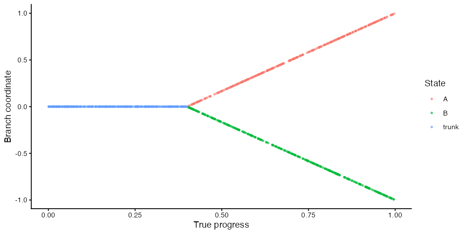
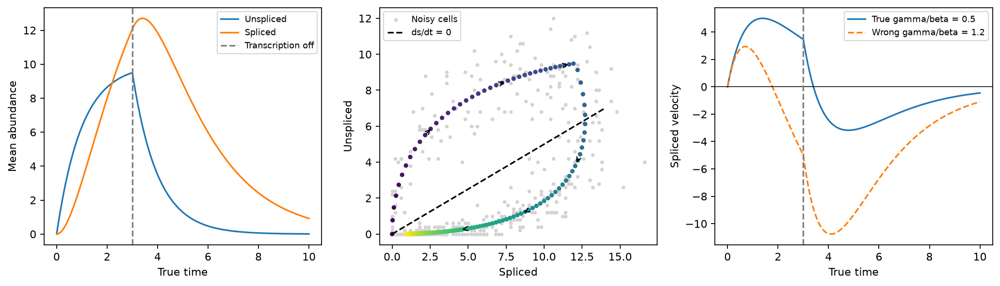

# 专题概述

细胞分化是一个连续的动态过程，但 scRNA-seq 对每个细胞只产生一次"快照"。如何从静态的横断面数据重建动态的分化路径？拟时序分析（Trajectory Inference, TI）的核心假设是：转录组相似的细胞处于相近的分化状态，因此细胞间的转录组距离编码了分化的连续性。基于此，可以为每个细胞赋予一个"伪时间"（Pseudotime）坐标，刻画其在分化轨迹上的相对位置。但拟时序本身没有方向——它只能说"这些细胞在一条路径上"，却无法判断分化是从 A 到 B 还是从 B 到 A。RNA Velocity 通过未剪接 pre-mRNA 与成熟 mRNA 的丰度比值推断转录的瞬时变化方向，为轨迹注入真实的时间箭头。本专题讲解拟时序的算法逻辑与 Monocle 3 原理及实操，以及 RNA Velocity 的 ODE 动力学模型与 scVelo 实操。

**学习目标**：理解拟时序推断的核心假设与方法演进；掌握 Monocle 3 的预处理、分区、主图学习、定根与图自相关检验；能用分叉模拟区分拓扑恢复与根选择的作用；理解 RNA Velocity 的 ODE、相图与三类速度估计模式；能用脉冲模拟区分真实速度、测量误差与参数估计；掌握 scVelo 的计数层、邻域矩、动力学拟合和流线解释；了解两类方法的适用边界与失效情形。

---

# 拟时序分析

## 从快照到轨迹：核心假设

scRNA-seq 在解离组织时杀死了细胞，因此无法追踪同一个细胞随时间的变化。拟时序分析绕过这一限制的关键洞见是：在一个正在分化的细胞群体中，不同细胞恰好"凝固"在分化过程的不同阶段。如果在高维表达空间中，分化是渐进、连续的，那么处于相邻分化阶段的细胞在转录组上也彼此相邻。于是，大量细胞的横断面数据共同勾勒出一条连续的"轨迹"，沿轨迹的位置就是伪时间。

{#fig-differentiation width=85%}

需要强调，伪时间是一个**相对的、无单位的**坐标，它衡量细胞沿分化路径走了多远，而非真实的物理时间（小时或天）。两个伪时间相差 0.5 的细胞，其真实分化时间差并不固定。

## 拟时序方法的演进

拟时序工具的发展反映了对轨迹复杂度建模能力的提升：

- **DDRTree（Monocle 2）**：将细胞嵌入到一棵反向图嵌入（reversed graph embedding）学习出的树结构上，支持分叉但对参数敏感。
- **学习图（Learned Graph，Monocle 3）**：在 UMAP 降维空间中学习一个主图（principal graph），可表示更复杂的拓扑（多分叉、收敛、甚至环），是当前 Monocle 的主流方法。
- **主曲线（Slingshot）**：在已有的聚类与降维基础上拟合分支主曲线，对多谱系分化稳健，且能与任意降维嵌入兼容。
- **最优传输（WaddingtonOT）**：当有多个真实时间点采样时，用最优传输理论推断时间点之间的细胞状态转移概率，最接近真实动力学。

方法选择的实用原则：结构简单的线性/单分叉分化优先用 Slingshot（稳健、轻量）；拓扑复杂或需要拟时序差异基因检验时用 Monocle 3；有真实时间序列采样时考虑 WaddingtonOT。

## Monocle 3 原理与实操

Monocle 3 将横断面的表达相似性转换为一张低维主图，再依据指定的起点计算细胞沿图的距离。本节先解释各步的输入与输出，再以 PBMC 3k 演示对象构建和分析流程，最后用已知真相的分叉模拟检验结果。PBMC 沿用第 6 章的真实数据；模拟数据仅用于本节的机制说明，不能替代真实发育系统的验证。

### 从表达矩阵到主图：算法究竟学习了什么

输入是基因 × 细胞的原始计数矩阵 $K$。经过深度标准化、对数变换和 PCA 后，每个细胞由一个低维向量表示；UMAP 再生成用于学习轨迹的坐标 $z_i$。`cluster_cells()` 构建邻域结构，既生成聚类（cluster），也生成分区（partition）。聚类描述局部表达社区；分区描述更大尺度的连通结构，不能把一个聚类直接等同于一条分支。

`learn_graph()` 在 UMAP 空间中拟合主图（principal graph）。主图由少量代表性节点及其连边组成，近似细胞群的几何骨架。其反向图嵌入（reversed graph embedding）过程交替调整细胞与主节点的对应关系、节点位置及图结构，使图接近细胞分布，并用结构约束抑制不必要的复杂度。叶节点与分叉节点是拟合图的拓扑特征，需要额外证据才能解释为终末命运与命运决定点。具体接口见 [Monocle 3 主图函数说明](https://github.com/cole-trapnell-lab/monocle3/blob/master/R/learn_graph.R)。

| 步骤 | 核心问题 | 本节调用 | 主要输出 |
|---|---|---|---|
| 预处理 | 哪些表达变化共同构成主要变异？ | `preprocess_cds()` | 标准化后的 PCA 表示 |
| 非线性降维 | 哪些细胞具有相似的局部邻域？ | `reduce_dimension()` | UMAP 坐标 |
| 聚类与分区 | 哪些社区相邻，哪些大群体缺乏连接？ | `cluster_cells()` | cluster 与 partition 标签 |
| 学图 | 用什么几何骨架近似这些细胞？ | `learn_graph()` | 主节点、连边及细胞投影 |
| 定根与排序 | 从哪个生物学起点衡量进程？ | `order_cells()` | 相对根的伪时间 |
| 基因检验 | 哪些基因在图的相邻位置表达相似？ | `graph_test()` | Moran's I、P 值和 q 值 |

: Monocle 3 各分析步骤的职责与输出 {#tbl-monocle-workflow}

`use_partition = TRUE` 表示分别在各分区中学图；设为 `FALSE` 则跨分区拟合一张图。不能仅为得到连续曲线就关闭分区，因为这样可能把缺乏过渡细胞的群体连接起来。`close_loop = FALSE` 关闭额外的闭环步骤，本节用它演示不含环的轨迹；若研究细胞周期等循环过程，需要重新评估该设置。UMAP 的邻居数、PCA 维度和主图剪枝参数都会影响分支形态，图形本身不是细胞谱系的直接观测。

### 伪时间是沿图的距离：根改变什么

在主图投影所诱导的细胞图 $H$ 上，记根对应的起始位置集合为 $R$。伪时间的概念可写成

$$
\tau_i=\min_{r\in R}d_H(r,i),\qquad
d_H(r,i)=\min_{p:r\leadsto i}\sum_{e\in p}\ell_e,
$$

其中 $\ell_e$ 是图边的长度。它使用的是沿图的最短路径距离，不是 UMAP 图上到根的一条直线距离，也不是细胞在样本表中的排列序号。Monocle 3 通过细胞投影与根附近的代表细胞实现这一计算；上式是其距离定义的概念表达，并不意味着每个指定根细胞的输出都严格等于 0。[`order_cells()` 函数说明](https://github.com/cole-trapnell-lab/monocle3/blob/master/R/order_cells.R)支持用细胞条形码 `root_cells` 或主节点名 `root_pr_nodes` 指定起点，两者不能同时指定。

在一条简单路径上，把根从一端换到另一端会逆转排序。在分叉图上，换根可能使某条末端分支成为新的起始段，并重新组织其他分支的距离关系，不能简单视为所有细胞的时间都乘以 −1。若一个连通分量中没有可达的根，该分量的伪时间可为 `Inf`；这表示没有定义从已选根出发的路径，不表示这些细胞“发育得无限晚”。不同分区即使各自设置了根，其伪时间也没有自动校准到共同的物理时间轴。

:::warning
**方向需要外部证据：** 主图只描述表达的几何结构。真实采样时间、谱系示踪、已知早期状态和独立的标志基因证据可用于选择根。成熟 PBMC 中某类细胞的名称不能直接充当“祖细胞”证据；RNA Velocity 也依赖动力学假设，应作为补充证据评估。
:::

### 真实数据实操：从原始计数显式构建对象

下面延续专题 6.3 的 Seurat 对象 `pbmc`，要求已完成质控与注释，且元数据包含 `cell_type`。原始矩阵来自 `/Users/angdong/Documents/bio_example/SingleCell/filtered_gene_bc_matrices/hg19/`。为减少把不相关成熟谱系连接起来的风险，这里只取 `CD14+ Mono` 与 `FCGR3A+ Mono` 两类单核细胞。**这仍是流程演示，不能据此宣称存在 CD14+ 向 FCGR3A+ 的真实分化轨迹。**

:::note
**运行环境与核验范围：** 实操需要 `monocle3`、`Seurat`、`Matrix`、`SummarizedExperiment` 和 `ggplot2`；图结构检查还使用 `igraph`。`monocle3` 的安装步骤见[官方安装说明](https://cole-trapnell-lab.github.io/monocle3/docs/installation/)。以下代码明确给出对象与函数依赖，不再调用未定义的根节点辅助函数。本次编辑环境未安装 `monocle3`，因此完整主图拟合、伪时间和图检验代码尚未实测；模拟计数的生成与基础检查可独立核验。
:::

```r
library(Seurat)
library(monocle3)

stopifnot("cell_type" %in% colnames(pbmc[[]]))
mono_cells <- colnames(pbmc)[
    pbmc$cell_type %in% c("CD14+ Mono", "FCGR3A+ Mono")]
stopifnot(length(mono_cells) > 50)
mono <- subset(pbmc, cells = mono_cells)

# Rejoin split RNA layers before extracting raw counts in Seurat v5
mono <- JoinLayers(mono, assay = "RNA")
counts_mono <- LayerData(mono, assay = "RNA", layer = "counts")
cell_meta <- mono[[]][colnames(counts_mono), , drop = FALSE]
gene_meta <- data.frame(gene_short_name = rownames(counts_mono),
                        row.names = rownames(counts_mono))
stopifnot(identical(colnames(counts_mono), rownames(cell_meta)))

cds <- new_cell_data_set(counts_mono,
                         cell_metadata = cell_meta,
                         gene_metadata = gene_meta)
keep <- Matrix::rowSums(SummarizedExperiment::assay(cds, "counts") > 0) >= 10
cds <- cds[keep, ]
```

`cell_data_set` 同时保存计数、细胞元数据、基因注释及后续图结构。输入矩阵的列名必须与细胞元数据行名一致，行名必须与基因元数据行名一致。`gene_short_name` 用于显示基因名称。本例直接用 `new_cell_data_set()` 构建对象，避免把 Seurat 中已有的 UMAP、聚类或近邻结构误认为 Monocle 3 已重新拟合的结果。输入保留原始 RNA 计数，不能换成 `scale.data` 或整合后的表达值；对象结构要求见[官方入门说明](https://cole-trapnell-lab.github.io/monocle3/docs/getting_started/)。

### 预处理、分区与学图：先检查结构，再计算距离

`preprocess_cds(..., norm_method = "log")` 处理测序深度并对数变换，使用 PCA 压缩基因维度；`num_dim = 30` 是保留的主成分数，不是分支数。它可以通过 `use_genes` 指定特征，但不会自动沿用 Seurat 的高变基因列表。本例先过滤低检出基因，再在保留的基因上重算 PCA。该行为见 [`preprocess_cds()` 参数说明](https://github.com/cole-trapnell-lab/monocle3/blob/master/R/preprocess_cds.R)。

```r
set.seed(2026)
cds <- preprocess_cds(cds, method = "PCA", num_dim = 30,
                       norm_method = "log")
cds <- reduce_dimension(cds, reduction_method = "UMAP",
                        preprocess_method = "PCA",
                        umap.n_neighbors = 30,
                        umap.fast_sgd = FALSE, cores = 1)
cds <- cluster_cells(cds, reduction_method = "UMAP", random_seed = 2026)
table(partition = partitions(cds), cell_type = cds$cell_type)
cds <- learn_graph(cds, use_partition = TRUE, close_loop = FALSE)
```

先查看分区与原注释的交叉表。如果两类细胞完全分属于互不连接的分区，数据就没有提供足够的跨群过渡证据，不应为了预设的发育故事强行连图。若出现细小分支，还要排查稀有群体、双细胞、低质量细胞，以及 UMAP 和剪枝参数的影响。UMAP 参数含义见 [`reduce_dimension()` 说明](https://github.com/cole-trapnell-lab/monocle3/blob/master/R/reduce_dimensions.R)，聚类与分区的区别见 [`cluster_cells()` 说明](https://github.com/cole-trapnell-lab/monocle3/blob/master/R/cluster_cells.R)。

```r
plot_cells(cds, color_cells_by = "cell_type",
           label_groups_by_cluster = FALSE,
           label_leaves = TRUE, label_branch_points = TRUE)
```

上述绘图代码按原细胞类型给主图着色，用于检查连边是否穿过有细胞支持的区域，而不是仅观察曲线是否平滑。真实研究中应在已知的候选谱系内重新预处理和学图，并检查采样时间、批次与质量指标在图上的分布。

### 显式指定演示根，并检查不可达细胞

PBMC 3k 没有可用于本例的早期采样时间或祖细胞标签。为了展示非交互调用，下面按条形码排序，选第一个 CD14+ 单核细胞作为**演示参考细胞**；这只是可复现的坐标起点，不是“最早细胞”的判定。真实数据分析必须将该选择替换为有独立生物学支持的根。

```r
root_candidates <- colnames(cds)[cds$cell_type == "CD14+ Mono"]
stopifnot(length(root_candidates) > 0)
demo_root <- sort(root_candidates)[1]
cds <- order_cells(cds, root_cells = demo_root)
pt <- pseudotime(cds)
table(partition = partitions(cds), reachable = is.finite(pt))
if (any(is.finite(pt))) summary(pt[is.finite(pt)])
```

如果其他分区的细胞为 `Inf`，应保留这个诊断结果。只有存在独立早期证据时，才为相应连通分量另外设置根；不能为了消除 `Inf` 随意给每群添加起点。一个分区中也可能存在多个图连通分量，因此有必要进一步检查实际图的连通性。

```r
plot_cells(cds, color_cells_by = "pseudotime",
           label_groups_by_cluster = FALSE,
           label_leaves = FALSE, label_branch_points = FALSE)
```

该绘图代码按伪时间着色，颜色梯度来自指定参考后的距离计算；出现平滑梯度本身并不能证实存在动态过程。用于排序的根、拓扑参数和用于验证的外部证据都应在分析记录中明确说明。

### `graph_test()`：图自相关不是时间回归

令 $x_i$ 为某基因用于检验的标准化、变换后表达，$w_{ij}$ 为细胞邻域权重，$S_0=\sum_{ij}w_{ij}$，$n$ 为细胞数。Moran's I 的基本形式为

$$
I=\frac{n}{S_0}
\frac{\sum_i\sum_j w_{ij}(x_i-\bar x)(x_j-\bar x)}
     {\sum_i(x_i-\bar x)^2}.
$$

分子衡量图上相邻细胞的表达偏差是否同向，分母按总体表达变异标准化。较大的正值表示高表达邻接高表达、低表达邻接低表达。`neighbor_graph = "principal_graph"` 利用细胞在主图上的投影约束邻接关系，并非直接把主节点当作被检验的观测。具体实现见 [`graph_test()` 源码与说明](https://github.com/cole-trapnell-lab/monocle3/blob/master/R/graph_test.R)。

```r
traj_genes <- graph_test(cds, neighbor_graph = "principal_graph", cores = 1)
ok <- traj_genes$status == "OK" & is.finite(traj_genes$q_value) &
      is.finite(traj_genes$morans_I)
traj_sig <- traj_genes[which(ok & traj_genes$q_value < 0.05 &
                            traj_genes$morans_I > 0), , drop = FALSE]
traj_sig <- traj_sig[order(-traj_sig$morans_I), , drop = FALSE]
head(traj_sig[, c("gene_short_name", "morans_I", "q_value")], 10)
```

该检验不以 `pseudotime` 作为回归自变量。保持表达与主图不变、只更换根时，伪时间可以改变，而该检验的统计目标不变。一个基因在某条分支特异表达、在路径中段出现峰值，或沿图逐渐增加，都可能产生正自相关。因此显著结果应称为**轨迹相关候选基因**，不能直接称为单调变化基因、上游驱动因子或因果调控基因；还需在具体分支上查看表达模式。[官方差异分析说明](https://cole-trapnell-lab.github.io/monocle3/docs/differential/)区分了图自相关分析与显式回归模型。

此外，轨迹和基因检验往往来自同一批表达数据，图估计的不确定性并未被完整传播到这些 q 值中。它也没有自动把多供体设计中的“样本”作为重复单位。因此本节结果用于探索和提出假设；处理效应的推断仍需回到独立样本及适当的统计模型（参见专题 7.1）。

### 分叉模拟：在已知真相下检查轨迹

为了分别观察拓扑恢复与定根的作用，构造 900 个细胞、600 个基因的分叉系统。前 300 个细胞位于共同主干，真实进程 $t\in[0,0.4]$；另外两组各 300 个细胞位于 A、B 分支，$t\in[0.4,1]$。令

$$
u_i=\max\left(\frac{t_i-0.4}{0.6},0\right),\qquad
b_i=\begin{cases}0,&\text{主干},\\1,&\text{A 分支},\\-1,&\text{B 分支},\end{cases}
\qquad z_i^{\mathrm{truth}}=(t_i,b_i u_i).
$$

$z_i^{\mathrm{truth}}$ 是用于展示的真实几何坐标，不输入降维或学图。计数模型为

$$
K_{gi}\sim\operatorname{NB}(\mu_{gi},\phi=0.1),\qquad
\log\mu_{gi}=\log s_i+a_g+f_g(t_i,b_i).
$$

其中 $s_i$ 为随机捕获深度因子，$a_g$ 为基准对数表达。设置五类变化基因，每类 60 个：沿进程升高（$2t$）、降低（$2(1-t)$）、A 分支特异（$2u\mathbb{1}(b=1)$）、B 分支特异（$2u\mathbb{1}(b=-1)$），以及中段达峰（$2\exp[-(t-0.4)^2/(2\times0.12^2)]$）。其余 300 个基因没有时间或分支效应。这样既有单调变化，也有非单调与分支特异变化，便于理解 `graph_test()` 的检验对象。

下面的生成代码只依赖基础 R。`true_time` 和 `true_state` 作为评价真相保存；分析函数不会因为元数据中有这些列就自动使用它们。

```r
set.seed(2026)
n_each <- 300
n_genes <- 600
true_state <- rep(c("trunk", "A", "B"), each = n_each)
true_time <- c(runif(n_each, 0, 0.4),
               runif(n_each, 0.4, 1), runif(n_each, 0.4, 1))
u <- pmax((true_time - 0.4) / 0.6, 0)
branch_sign <- c(trunk = 0, A = 1, B = -1)[true_state]
depth <- exp(rnorm(length(true_time), 0, 0.2))
base_log <- runif(n_genes, log(2), log(8))
log_mu <- outer(base_log, rep(1, length(true_time)))
log_mu <- sweep(log_mu, 2, log(depth), "+")

add_effect <- function(M, rows, effect) {
    M[rows, ] <- sweep(M[rows, , drop = FALSE], 2, effect, "+")
    M
}
log_mu <- add_effect(log_mu, 1:60, 2 * true_time)
log_mu <- add_effect(log_mu, 61:120, 2 * (1 - true_time))
log_mu <- add_effect(log_mu, 121:180, 2 * u * (true_state == "A"))
log_mu <- add_effect(log_mu, 181:240, 2 * u * (true_state == "B"))
log_mu <- add_effect(log_mu, 241:300,
                     2 * exp(-(true_time - 0.4)^2 / (2 * 0.12^2)))
sim_counts <- matrix(rnbinom(length(log_mu), mu = exp(log_mu), size = 10),
                      nrow = n_genes,
                      dimnames = list(paste0("g", seq_len(n_genes)),
                                      paste0("cell", seq_along(true_time))))
sim_meta <- data.frame(true_time, true_state,
                        truth_x = true_time, truth_y = branch_sign * u,
                        row.names = colnames(sim_counts))
gene_class <- rep(c("increasing", "decreasing", "branch_A", "branch_B",
                     "transient", "null"), c(rep(60, 5), 300))
sim_gene_meta <- data.frame(gene_short_name = rownames(sim_counts),
                             gene_class, row.names = rownames(sim_counts))
stopifnot(all(sim_counts >= 0), all(colSums(sim_counts) > 0),
          identical(colnames(sim_counts), rownames(sim_meta)))
table(sim_gene_meta$gene_class)
```

先画出生成真相，避免把拟合结果误当作预设真相。

```r
ggplot2::ggplot(sim_meta, ggplot2::aes(truth_x, truth_y, color = true_state)) +
    ggplot2::geom_point(size = 0.8, alpha = 0.6) +
    ggplot2::labs(x = "True progress", y = "Branch coordinate", color = "State") +
    ggplot2::theme_classic()
```

{#fig-monocle-sim-truth width=85%}

@fig-monocle-sim-truth 展示的坐标和 `true_time` 均由生成机制确定。下面只把 `sim_counts` 用作表达输入，重新计算 PCA、UMAP、分区和主图，不手动注入真实坐标，也不预先指定某个聚类一定对应某条分支。

```r
library(monocle3)
sim_cds <- new_cell_data_set(sim_counts, cell_metadata = sim_meta,
                             gene_metadata = sim_gene_meta)
set.seed(2026)
sim_cds <- preprocess_cds(sim_cds, num_dim = 20, norm_method = "log")
sim_cds <- reduce_dimension(sim_cds, preprocess_method = "PCA",
                            umap.n_neighbors = 30,
                            umap.fast_sgd = FALSE, cores = 1)
sim_cds <- cluster_cells(sim_cds, random_seed = 2026)
table(partition = partitions(sim_cds), truth = sim_cds$true_state)
sim_cds <- learn_graph(sim_cds, use_partition = TRUE, close_loop = FALSE)
sim_graph <- principal_graph(sim_cds)[["UMAP"]]
table(igraph::degree(sim_graph))

# Use known early time only for root selection, after learning the graph
early_root <- rownames(sim_meta)[which.min(sim_meta$true_time)]
sim_early <- order_cells(sim_cds, root_cells = early_root)
```

```r
plot_cells(sim_early, color_cells_by = "pseudotime",
           label_groups_by_cluster = FALSE,
           label_leaves = TRUE, label_branch_points = TRUE)
```

运行上述绘图代码后，先检查主干与 A、B 两条分支是否可区分，再检查图的连接与真实状态是否一致。上面的节点度数表可辅助检查：度为 1 的节点是叶节点，度至少为 3 的节点是分叉节点；但数出三个叶节点不足以证明恢复了正确的 Y 形拓扑。UMAP 分离、主图剪枝和随机初始化都可能使结果偏离生成真相。本节不预设固定的分区数、叶节点数或相关系数。

### 用三项检查区分定根错误与拓扑错误

第一项检查是**根的可达性与分支内部的时间排序**。对于已知 A、B 分支，分别检查从共同主干到各自终点的排序，不能只把两条分支的细胞混在一起计算一个相关系数。不同末端的几何路径长短未必对应相同的真实时间速率。

第二项检查是**只改变根，保持图不变**。选择 A 分支最晚的细胞重新排序。此时 A 末端成为新的起点，排序可能沿 A 分支回到分叉点，再进入主干或 B 分支；这与早期根对应的发育解释不同。

```r
late_a <- which(sim_meta$true_state == "A")
late_root <- rownames(sim_meta)[late_a[which.max(sim_meta$true_time[late_a])]]
sim_late <- order_cells(sim_cds, root_cells = late_root)

check_order <- function(obj) {
    pt <- pseudotime(obj)[rownames(sim_meta)]
    rho <- sapply(c("A", "B"), function(b) {
        ix <- sim_meta$true_state %in% c("trunk", b) & is.finite(pt)
        if (sum(ix) < 3 || length(unique(pt[ix])) < 2) return(NA_real_)
        cor(pt[ix], sim_meta$true_time[ix], method = "spearman")
    })
    c(finite_fraction = mean(is.finite(pt)), rho)
}
rbind(early_root = check_order(sim_early),
      late_A_root = check_order(sim_late))
```

早期根下，若拓扑恢复合理，预期两个根到末端路径内的伪时间与真时间总体正相关；晚期 A 根下，至少 A 路径的排序解释应改变。具体相关数值需要实际运行后读取，不能保证恰好为 ±1。若早期根下仍有大量不可达细胞或明显错误连边，应先检查拓扑与采样覆盖；仅改根不能修复错误的连接。

第三项检查是**比较变化基因与恒定基因的图自相关**。将五类变化基因与 `null` 基因分别汇总，不把一次显著性输出当成算法准确率的普遍保证。

```r
sim_test <- graph_test(sim_early, neighbor_graph = "principal_graph", cores = 1)
sim_test$gene_class <- sim_gene_meta[rownames(sim_test), "gene_class"]
sim_test$tested <- sim_test$status == "OK" &
                   is.finite(sim_test$q_value) & is.finite(sim_test$morans_I)
sim_test$hit <- sim_test$tested & !is.na(sim_test$q_value) &
                sim_test$q_value < 0.05 & sim_test$morans_I > 0
sim_test$hit[is.na(sim_test$hit)] <- FALSE
sim_summary <- do.call(rbind, lapply(split(sim_test, sim_test$gene_class),
    function(d) data.frame(n_genes = nrow(d),
                           n_tested = sum(d$tested, na.rm = TRUE),
                           n_hits = sum(d$hit))))
sim_summary
```

预期单调、瞬时峰值和分支特异基因都可能呈现图自相关，这与检验不要求单调变化的原理一致。`null` 指的是生成模型中 $f_g=0$，并不表示观察计数严格恒定；深度标准化、有限样本、组成变化及表达数据参与学图都会影响检出。`n_tested` 使检验失败的基因可见，不能把失败直接归为“不显著”。这些结果只描述本次模拟。

:::tip
**进一步实验：** 将 `size = 10` 改为 `size = 2` 可增加计数噪声；删除分叉附近的一段细胞可制造采样缺口。每次修改后都要从计数构建对象并重新降维、聚类和学图，再检查可达性、拓扑与分支内排序。对照“固定图只换根”的实验，可以区分方向选择带来的变化与图结构不稳定带来的变化。
:::

---

# RNA Velocity

## 剪接动力学的基本思想

RNA Velocity 利用未剪接 RNA（unspliced，$u$）与已剪接 RNA（spliced，$s$）之间的动态失衡，估计表达状态的局部变化方向。其依据不是“未剪接比例高就一定处于早期”，而是**在一个基因的剪接与降解速率给定时，当前未剪接 RNA 是否足以支持已剪接 RNA 继续增加**。同一表达量可以出现在诱导阶段和抑制阶段，两者的未剪接量不同，因而具有不同的未来变化方向。

{#fig-rna-splicing width=85%}

单细胞测序仍是横断面观测，并未连续追踪同一细胞。RNA Velocity 通过动力学模型连接这些快照，因此得到的是模型支持的局部表达变化，不是直接测量的细胞移动、命运转换或谱系关系。

## ODE 模型：从物质平衡到速度的正负

对一个基因，基本模型为（La Manno et al., 2018）：

$$
\frac{du}{dt}=\alpha(t)-\beta u,\qquad
\frac{ds}{dt}=\beta u-\gamma s.
$$

这里 $\alpha(t)$ 是转录速率，单位为“分子数/时间”；$\beta$ 和 $\gamma$ 分别是剪接与降解速率常数，单位为“1/时间”。模型假设未剪接 RNA 以一阶速率被剪接，已剪接 RNA 以一阶速率降解；这一简化模型没有另设未剪接 RNA 的降解通道。不同基因可以具有不同的速率，但对同一基因的基本拟合通常假定这些速率在所分析的细胞状态间共享。

第一式是未剪接库的流入减流出；第二式是已剪接库的流入减流出。RNA velocity 在此定义为

$$
v_s=\frac{ds}{dt}=\beta u-\gamma s
=\beta\left(u-\frac{\gamma}{\beta}s\right).
$$

因此 $v_s>0$ 表示已剪接 RNA 当前正在增加，$v_s<0$ 表示正在减少。若 $\beta=1$、$\gamma=0.5$、$s=8$，则 $u=6$ 时 $v_s=2$，$u=2$ 时 $v_s=-2$。同样的已剪接表达量可以对应相反的速度，不能仅凭表达高低判断方向。

### 相图与稳态线：为什么要比较同一个基因的两类 RNA

相图（phase portrait）以 $s$ 为横轴、$u$ 为纵轴，将不同细胞作为同一基因的观测点。满足 $ds/dt=0$ 的位置构成直线

$$
u=\frac{\gamma}{\beta}s.
$$

该线是 **$s$ 的零变化线**：线上方 $s$ 增加，线下方 $s$ 减少；它并不要求 $du/dt$ 也等于 0。只有当 $\alpha$ 恒定，且两式都为 0 时，系统才处于完整稳态：$u^*=\alpha/\beta$、$s^*=\alpha/\gamma$。真实软件还可能估计尺度、偏置或基线表达，不能把任意数据中的一条过原点直线直接当作已知真相。

当转录从低水平开启，$u$ 先增加，$s$ 随后增加；转录关闭后，$u$ 开始下降，但已有的未剪接 RNA 仍可被剪接，故 $s$ 可能继续增加一段时间。**“转录关闭”与“已剪接 RNA 开始下降”不是同一时刻。**这一区别将在模拟中直接检验。

## 稳态、随机与动力学模型分别估计什么

横断面数据中的 $u$、$s$ 可观测，时间和速率通常未知。不同估计方法的区别，在于用什么约束从快照中恢复这些未知量。

| 模式 | 主要信息与估计思路 | 适用前提与解释边界 |
|---|---|---|
| 确定性稳态模型（deterministic） | 从表达分布的极端区域估计稳态关系，以偏离该关系的残差判断速度 | 需要足够的近稳态信息；错误斜率可能使速度符号翻转 |
| 随机模型（stochastic） | 在一阶矩之外利用二阶矩约束剪接动态 | 增加统计信息，但不自动消除稳态关系和邻域选择造成的偏差 |
| 动力学模型（dynamical） | 拟合完整的诱导—抑制相轨迹，迭代估计速率、开关时间、潜在时间与状态 | 可利用非稳态细胞，但依赖状态覆盖、参数可识别性和模型是否符合实际 |

: scVelo 三类速度估计模式的主要区别 {#tbl-velocity-models}

动力学模型的直觉是：先给定参数，把细胞投影到预测的相轨迹上，估计它们处于诱导还是抑制阶段、位于什么潜在时间；再根据这些状态更新参数，反复迭代（Bergen et al., 2020）。它并非直接用观测采样时间做回归。`recover_dynamics()` 实现基于似然的迭代拟合，参数说明见[官方接口文档](https://scvelo.readthedocs.io/en/stable/scvelo.tl.recover_dynamics.html)。

更灵活并不保证更准确。如果只采到稳态附近的细胞，或只覆盖相轨迹很短的一段，多组参数可能解释相似的观测；若基因反复开关、剪接速率随状态改变，单次诱导—抑制模型也可能失配。因此应结合单基因相图、拟合覆盖与参数敏感性选择模型，不能仅按模型复杂度排名。

### 速率与时间的尺度为何不能直接当作小时

没有外部时钟时，令 $t'=ct$，并将所有速率除以 $c$，同一条 $u$–$s$ 相轨迹仍然成立。这说明表达快照本身通常不能唯一确定绝对时间尺度。未剪接与已剪接 RNA 若有不同捕获效率，观测相图还会被拉伸，影响斜率与速率的解释。

动力学模型先得到基因特异的时间，再将支持一致进程的基因时间整合为共享潜在时间（latent time）。它与 Monocle 3 的图距离不是同一个量，不能因为名称含有 time 就直接解释为实验后的小时数。`latent_time()` 的对齐和根选择接口见[官方说明](https://scvelo.readthedocs.io/en/stable/scvelo.tl.latent_time.html)。

## 已知真相的模拟：转录开启、关闭与表达滞后

下面先不拟合 scVelo，而是用已知参数解 ODE，分清楚“模型规定的真实速度”与“从噪声数据估计的速度”。模拟包含 400 个细胞、60 个基因：50 个基因经历一次转录脉冲，另 10 个基因始终处于各自稳态。细胞在同一条进程的 $[0,10]$ 区间随机取样，各脉冲基因具有不同的开启和关闭时间。

对脉冲基因 $g$，设

$$
\alpha_g(t)=a_g\mathbb{1}(t_{g,\mathrm{on}}\le t<t_{g,\mathrm{off}}),
\qquad u_g(0)=s_g(0)=0.
$$

数值求解给出无噪声均值 $U_{ig}$、$S_{ig}$，真实速度为 $V_{ig}=\beta_g U_{ig}-\gamma_g S_{ig}$。稳态对照直接设置 $U=a/\beta$、$S=a/\gamma$，因而真实速度为 0。观测计数另从 $K^u_{ig}\sim\operatorname{Poisson}(cU_{ig})$、$K^s_{ig}\sim\operatorname{Poisson}(cS_{ig})$ 抽取，取公共捕获尺度 $c=5$。这只是给定均值后的独立测量噪声，不是分子反应的完整随机过程。

:::note
**运行环境与核验范围：** ODE 模拟与下列绘图需要 `numpy`、`scipy` 和 `matplotlib`，可独立运行。后续可选拟合还需要 `anndata`、`scanpy`、`scvelo` 和 `pandas`。本次编辑环境未安装 `anndata`、`scanpy` 与 `scvelo`，因此将核验模拟、导数与图示，完整 scVelo 拟合示例尚未实测，不预设其拟合精度。
:::

### 从连续动力学生成两层计数

`pulse_path()` 分别在转录开启和关闭后的区间积分，避免让求解器跨越转录速率的不连续开关。返回的两行依次为 $u$、$s$；汇总矩阵则采用 AnnData 的“细胞 × 基因”方向，与 R 中常用的“基因 × 细胞”相反。

```python
import numpy as np
from scipy.integrate import solve_ivp

def pulse_path(times, alpha, beta, gamma, t_on, t_off, t_end=10.0):
    times = np.asarray(times)
    assert 0 <= t_on < t_off < t_end
    assert np.all((times >= 0) & (times <= t_end))
    def rhs(rate):
        return lambda t, y: [rate - beta * y[0],
                             beta * y[0] - gamma * y[1]]
    on = solve_ivp(rhs(alpha), (t_on, t_off), [0.0, 0.0],
                   dense_output=True, rtol=1e-9, atol=1e-10)
    off = solve_ivp(rhs(0.0), (t_off, t_end), on.y[:, -1],
                    dense_output=True, rtol=1e-9, atol=1e-10)
    assert on.success and off.success
    values = np.zeros((2, len(times)))
    active = (times >= t_on) & (times < t_off)
    repressed = times >= t_off
    values[:, active] = on.sol(times[active])
    values[:, repressed] = off.sol(times[repressed])
    return np.maximum(values, 0.0)

rng = np.random.default_rng(2026)
n_cells, n_genes = 400, 60
true_time_v = rng.uniform(0, 10, n_cells)
alpha_v = rng.uniform(5, 15, n_genes)
beta_v = rng.uniform(0.5, 1.5, n_genes)
gamma_v = rng.uniform(0.3, 0.9, n_genes)
t_on_v = rng.uniform(0, 2, n_genes)
t_off_v = rng.uniform(3, 6, n_genes)
alpha_v[0], beta_v[0], gamma_v[0] = 10.0, 1.0, 0.5
t_on_v[0], t_off_v[0] = 0.0, 3.0
is_pulse_v = np.arange(n_genes) < 50
U = np.zeros((n_cells, n_genes))
S = np.zeros_like(U)
for g in range(n_genes):
    if is_pulse_v[g]:
        U[:, g], S[:, g] = pulse_path(
            true_time_v, alpha_v[g], beta_v[g], gamma_v[g],
            t_on_v[g], t_off_v[g])
    else:
        U[:, g] = alpha_v[g] / beta_v[g]
        S[:, g] = alpha_v[g] / gamma_v[g]
V_true = U * beta_v - S * gamma_v
capture_scale = 5.0
U_counts = rng.poisson(capture_scale * U)
S_counts = rng.poisson(capture_scale * S)
assert U_counts.shape == S_counts.shape == (400, 60)
assert np.allclose(V_true[:, ~is_pulse_v], 0)
assert np.all((U_counts + S_counts).sum(axis=1) > 0)
```

`true_time_v` 没有按数值排序，细胞输入顺序不会泄露时间排序。第一个基因固定为 $a=10$、$\beta=1$、$\gamma=0.5$，在 $t=0$ 开启、$t=3$ 关闭，用于下面的相图示范。其他基因的异步开关提供多基因动态信息；稳态对照用于检查“没有真实速度时是否仍估计出明显方向”。

### 用一张图检查延迟与速度符号

```python
import matplotlib.pyplot as plt

grid_v = np.linspace(0, 10, 1001)
u0, s0 = pulse_path(grid_v, 10.0, 1.0, 0.5, 0.0, 3.0)
v0 = u0 - 0.5 * s0
v_wrong = u0 - 1.2 * s0
fig, axes = plt.subplots(1, 3, figsize=(13, 3.8))
axes[0].plot(grid_v, u0, label="Unspliced")
axes[0].plot(grid_v, s0, label="Spliced")
axes[0].axvline(3, color="gray", linestyle="--", label="Transcription off")
axes[0].set(xlabel="True time", ylabel="Mean abundance")
axes[0].legend(fontsize=8)
axes[1].scatter(S_counts[:, 0] / capture_scale,
                 U_counts[:, 0] / capture_scale,
                 s=6, color="lightgray", label="Noisy cells")
axes[1].scatter(s0[::8], u0[::8], c=grid_v[::8], s=10, cmap="viridis")
for k in (80, 180, 280, 380, 500, 650):
    axes[1].annotate("", xy=(s0[k + 10], u0[k + 10]),
                     xytext=(s0[k], u0[k]),
                     arrowprops=dict(arrowstyle="->", color="black"))
xline = np.linspace(0, s0.max() * 1.1, 100)
axes[1].plot(xline, 0.5 * xline, "k--", label="ds/dt = 0")
axes[1].set(xlabel="Spliced", ylabel="Unspliced")
axes[1].legend(fontsize=8)
axes[2].plot(grid_v, v0, label="True gamma/beta = 0.5")
axes[2].plot(grid_v, v_wrong, "--", label="Wrong gamma/beta = 1.2")
axes[2].axhline(0, color="black", linewidth=0.7)
axes[2].axvline(3, color="gray", linestyle="--")
axes[2].set(xlabel="True time", ylabel="Spliced velocity")
axes[2].legend(fontsize=8)
fig.tight_layout()
plt.show()
```

{#fig-velocity-pulse-simulation width=95%}

@fig-velocity-pulse-simulation 的中图箭头来自生成时的真实时间，**不是 scVelo 恢复结果**。比较左右两图可见：转录在 $t=3$ 关闭时，$u$ 约为 9.50、$s$ 约为 12.07，故 $v_s\approx9.50-0.5\times12.07=3.47>0$。转录速率已经变为 0，但尚未剪接的 RNA 仍在补充已剪接库。

右图刻意把真实的 $\gamma/\beta=0.5$ 改成 1.2，演示**参数错误的后果**，并不是声称某种拟合方法必然估计出 1.2。例如在 $t=2$，$u\approx8.65$、$s\approx7.99$，真实速度约为 $+4.65$，错误参数给出的速度却约为 $-0.94$。相同快照可以因稳态线估错而得到相反方向。

### 用数值导数核验，而不只看箭头

先比较无噪声轨迹的数值导数与 ODE 给出的速度。随后对 Poisson 观测使用**已知真参数**计算速度，评价非近零区域的符号一致率。第二项仍不是参数恢复测试，而是展示测量噪声本身就会损伤方向判断。

```python
numerical_v = np.gradient(s0, grid_v)
away = (grid_v > 0.05) & (grid_v < 9.95) & (np.abs(grid_v - 3) > 0.05)
print("Maximum derivative error:", np.max(np.abs(numerical_v[away] - v0[away])))
assert np.max(np.abs(numerical_v[away] - v0[away])) < 0.01

V_oracle = (U_counts * beta_v - S_counts * gamma_v) / capture_scale
moving = np.abs(V_true) > 1.0
sign_agreement = np.mean(np.sign(V_oracle[moving]) == np.sign(V_true[moving]))
print("Oracle-parameter sign agreement:", sign_agreement)
print("Stationary-control mean absolute velocity:",
      np.mean(np.abs(V_oracle[:, ~is_pulse_v])))
```

`moving` 的阈值是本次模拟中为避免近零速度符号不稳定而设置的评价规则，不是真实数据的通用阈值。即便真参数已知，稳态对照也会因计数噪声出现非零估计；这说明“存在箭头”本身不是动态证据。固定参数可先隔离测量误差，之后才能进一步评价从未知参数恢复方向的能力。

## scVelo 原理与实操：每一步生成了什么

### 真实输入需要两层原始计数

真实流程需要从对齐结果或转录本定量中区分未剪接与已剪接 reads，例如通过 `velocyto` 或支持该任务的 `kb-python` 工作流生成两层计数。AnnData 采用“细胞 × 基因”布局，`layers["spliced"]` 和 `layers["unspliced"]` 必须具有一致的细胞条形码、基因顺序与形状。

本地 PBMC 3k 的普通 10x 基因计数矩阵没有分别提供这两层信息，不能靠复制矩阵或按固定比例拆分得到真实 RNA Velocity 输入。上一节的 Monocle 分叉模拟也没有生成剪接动力学，不能直接把那份计数当成 $s$，再随机构造 $u$。下面使用本节的 ODE 模拟说明完整接口；真实数据读取仅给出条件性示例。

```python
from pathlib import Path
import anndata as ad

# Illustrative input: this file must first be generated by a splicing-aware workflow
velocity_file = Path(
    "/Users/angdong/Documents/bio_example/SingleCell/pbmc3k_velocyto.h5ad")
if not velocity_file.exists():
    raise FileNotFoundError("Generate a spliced/unspliced AnnData before running this block")
adata_real = ad.read_h5ad(velocity_file)
assert {"spliced", "unspliced"}.issubset(adata_real.layers.keys())
assert adata_real.layers["spliced"].shape == adata_real.layers["unspliced"].shape
```

该块与后续模拟拟合相互独立；示例路径目前不是已存在数据的声明。真实输入还需检查样本、批次、两层 RNA 的检出率与相图质量，并按研究问题选择有连续状态覆盖的候选谱系。成熟 PBMC 的用途仍以流程演示为主。

### 从模拟构建 AnnData 并计算邻域矩

以下可选代码接在 ODE 模拟之后运行。它只把两层观测计数送入模型，不传入真实时间、参数、速度或稳态标签。`X` 用已剪接计数初始化；真实研究中若合并已有对象，应先核验基因名和细胞条形码，而不是按矩阵位置强行拼接。

```python
import anndata as ad
import scanpy as sc
import scvelo as scv

velocity_sim = ad.AnnData(X=S_counts.astype(np.float32))
velocity_sim.layers["spliced"] = S_counts.astype(np.float32)
velocity_sim.layers["unspliced"] = U_counts.astype(np.float32)
velocity_sim.obs_names = [f"vcell{i}" for i in range(n_cells)]
velocity_sim.var_names = [f"vg{g}" for g in range(n_genes)]
scv.pp.filter_and_normalize(velocity_sim, min_shared_counts=10,
                            n_top_genes=None)
sc.tl.pca(velocity_sim, n_comps=15, random_state=2026)
sc.pp.neighbors(velocity_sim, n_neighbors=30, n_pcs=15, random_state=2026)
scv.pp.moments(velocity_sim, n_pcs=15, n_neighbors=30)
sc.tl.umap(velocity_sim, random_state=2026)
```

过滤与标准化处理两层计数的尺度，`X` 用于表达结构的降维；常规流程只对 `X` 做对数变换，不把两层动力学输入也直接改成对数。`n_top_genes=None` 用于这份只有 60 个基因的教学模拟，不是大规模真实数据的默认建议。预处理含义见 [scVelo 基础流程](https://scvelo.readthedocs.io/en/stable/VelocityBasics.html)。

`moments()` 用近邻图做局部加权平均。若 $w_{ij}$ 为归一化邻域权重，可用 $M^u_{ig}\approx\sum_j w_{ij}u_{jg}$、$M^s_{ig}\approx\sum_j w_{ij}s_{jg}$ 理解 `layers["Mu"]` 和 `layers["Ms"]`。二阶矩提供局部乘积的统计信息，不等同于直接对每基因求总体方差。[官方矩计算说明](https://scvelo.readthedocs.io/en/stable/scvelo.pp.moments.html)给出了邻域与输出接口。

按细胞总量标准化还可能吸收真实的总体 RNA 含量变化，因此所得速度与分子数尺度的速度不必等价。平滑可以降低测量噪声，但如果近邻跨越不同谱系、相反动态或批次边界，也会把不相容的状态平均起来。已有整合 UMAP 并不意味着两层计数的技术偏差已消失，不能仅凭漂亮的嵌入跳过这些检查。

### 拟合参数、计算速度，并检查单基因支持

```python
scv.tl.recover_dynamics(velocity_sim, var_names="all", n_jobs=1)
scv.tl.velocity(velocity_sim, mode="dynamical")
print(velocity_sim.var[["fit_alpha", "fit_beta", "fit_gamma",
                         "fit_likelihood"]].head())
print("Velocity matrix shape:", velocity_sim.layers["velocity"].shape)
scv.pl.scatter(velocity_sim, basis="vg0", color="velocity")
```

`recover_dynamics()` 在 `var` 中保存基因参数与拟合质量，在相轨迹上分配潜在状态和时间；`velocity(..., mode="dynamical")` 再利用这些估计生成细胞 × 基因的速度矩阵。`var_names="all"` 在本例中刻意尝试拟合全部基因，以便观察稳态对照的行为，不代表所有基因都能可靠恢复动力学。

参数数值可能受时间归一化和两层 RNA 的尺度拟合影响，不能把 `fit_beta`、`fit_gamma` 逐项与生成值作未经校准的直接比较。`fit_likelihood` 描述模型拟合支持，不是“这个基因是因果驱动因子的概率”。先观察 `vg0` 的相图是否覆盖诱导与抑制段、稳态对照是否缺乏可识别动态，再决定哪些基因能够支持整体方向。

### 从高维速度到转移图，再到 UMAP 流线

对细胞 $i$，多基因速度构成向量 $\boldsymbol v_i$。候选邻居 $j$ 的表达位移为 $\boldsymbol\delta_{ij}=\boldsymbol x_j-\boldsymbol x_i$，方向匹配的核心量是

$$
c_{ij}=\frac{\boldsymbol\delta_{ij}^{\mathsf T}\boldsymbol v_i}
{\|\boldsymbol\delta_{ij}\|\,\|\boldsymbol v_i\|}.
$$

正值表示朝向邻居的位移与预测速度相容。`velocity_graph()` 保存方向相似性图，后续步骤再将其转换为转移权重并投影到嵌入空间；该图不是原始计数的相关矩阵，其值也不能直接解释为经实验校准的命运概率。实现中的变换与邻域控制见[官方转移图说明](https://scvelo.readthedocs.io/en/stable/scvelo.tl.velocity_graph.html)。

```python
scv.tl.velocity_graph(velocity_sim, n_jobs=1)
scv.tl.latent_time(velocity_sim)

# Attach truth only after fitting, for evaluation and plotting
velocity_sim.obs["true_time"] = true_time_v
scv.pl.velocity_embedding_stream(velocity_sim, basis="umap", color="true_time")
scv.pl.scatter(velocity_sim, x="true_time", y="latent_time")
```

UMAP 流线是邻域转移与可视化插值的结果，不是直接把 ODE 中的 $ds/dt$ 当成二维坐标增量；箭头长度也不能解释为每小时移动距离。共享潜在时间结合基因动力学和根/终点信息，与上面的 ODE 生成时间需要比较排序一致性，而非要求数值完全相同。若拟合没有足够可靠的动态基因，潜在时间和转移图可能无法稳定计算，此时应检查拟合本身。

### 如何评价拟合结果，避免真相与预测混淆

第一，比较潜在时间与生成时间的 Spearman 相关，同时报告有限值覆盖率。第二，在动态基因中，逐基因比较估计速度与真实速度的符号；由于真实速度近零时符号没有稳定意义，评价时明确排除该区域。第三，单独检查稳态对照的估计速度与相图，不把全体细胞或基因平均后的一个分数当作充分证据。

```python
from scipy import sparse
from scipy.stats import spearmanr

lt = velocity_sim.obs["latent_time"].to_numpy()
finite = np.isfinite(lt)
print("Finite latent-time fraction:", finite.mean())
if finite.sum() > 3 and np.unique(lt[finite]).size > 1:
    print("Time rank correlation:", spearmanr(true_time_v[finite], lt[finite]).statistic)

estimated = velocity_sim.layers["velocity"]
estimated = estimated.toarray() if sparse.issparse(estimated) else np.asarray(estimated)
original_idx = np.array([int(name[2:]) for name in velocity_sim.var_names])
truth = V_true[:, original_idx]
eligible = np.isfinite(estimated) & (np.abs(truth) > 1.0)
gene_sign_scores = []
for j, g in enumerate(original_idx):
    mask = eligible[:, j]
    if is_pulse_v[g] and mask.sum() >= 20:
        gene_sign_scores.append(np.mean(
            np.sign(estimated[mask, j]) == np.sign(truth[mask, j])))
if gene_sign_scores:
    print("Median per-gene sign agreement:", np.median(gene_sign_scores))
print("Genes with direction scores:", len(gene_sign_scores))
```

这里仅比较速度符号，避免将模型归一化后的速度幅度与生成尺度直接混同。标准化本身也可能改变相对表达的动态，因此符号偏差不应全部归因于参数估计错误；基因过滤后还按名称重新对齐真相。报告分数时应同时保留过滤和拟合失败信息，因为只展示成功基因会高估总体恢复能力。该模拟符合所设的一次脉冲模型且只有一条进程，即使得到较好排序，也不能证明算法能够识别真实组织中的复杂分支、循环和状态依赖速率。

{{Wiki:RNA_velocity}}

## 方法的局限与结果判读

可靠的方向解释至少需要相容的动态模型、足够的相轨迹覆盖、质量可接受的两层计数，以及不把不相关状态混合的邻域。常见失败来源包括：

- **缺乏动态信息**：接近稳态的群体可能难以区分方向，噪声仍可形成非零箭头；成熟 PBMC 中也可能有活化或应激状态，不能仅凭样本名称断定全部细胞都无动态。
- **模型失配**：多次转录脉冲、状态依赖的剪接速率或降解速率，可能使单一相轨迹无法解释所有细胞。
- **采样不完整**：缺少早期、晚期或过渡状态时，开关位置与速率可能不可识别；增加模型复杂度不能补回缺失的状态。
- **技术与邻域偏差**：内含子计数规则、两层捕获效率、文库差异和跨谱系平滑都可能改变相图及方向。
- **可视化过度解释**：流线可能跨越稀疏区域；改变 UMAP、邻居数或少数关键基因后方向不稳定，说明证据不足。

:::tip
**模拟中的进一步实验：** 将 `capture_scale` 从 5 降到 1，可观察更稀疏的测量如何影响方向；只保留关闭前的细胞，可检查缺少抑制段的后果；改变邻居数后重新拟合，可检查平滑敏感性。每次都应区分真实速度、真参数下的带噪计算，以及未知参数的模型估计，不只比较最终流线是否平滑。
:::

:::info
**结论边界：** Monocle 3 的图距离与 RNA Velocity 的动力学方向可以相互核验，但两者通常共享表达数据和邻域结构，并非完全独立的证据。一致只能增加支持，不能替代采样时间、谱系示踪或扰动验证；不一致时应检查定根、计数质量、模型失配与状态覆盖，必要时保留“方向尚不能确定”的结论。
:::

---

# 方法总结与衔接说明

本专题说明了如何从静态快照提出关于连续状态与变化方向的假设：Monocle 3 用主图及指定根定义相对距离，RNA Velocity 用剪接动力学估计局部表达变化。PBMC 示例展示对象与流程，分叉模拟和转录脉冲模拟分别用于核验拓扑、排序及速度的含义。真实研究应结合专题 7.1 的批次诊断与注释，检查技术因素是否扭曲邻域，同时避免整合抹去所研究的连续变化；已有整合图谱也不能替代 RNA Velocity 所需的两层原始计数。下一专题（7.3）将进一步追问：驱动这些分化与状态转变的，是哪些细胞间信号与转录因子调控网络？

---

# 课后自测 (Post-Lesson Quiz)

1. 拟时序分析如何从无法追踪单个细胞的横断面 scRNA-seq 数据中重建动态分化路径？其核心假设是什么？

2. "伪时间"（Pseudotime）与真实的物理时间有何区别？为什么说伪时间是相对的、无单位的？

3. Monocle 3 的 `graph_test()` 使用什么统计量？为什么它可以检出中段达峰或分支特异基因，却不能直接证明基因随时间单调变化？

4. 为什么 Monocle 3 需要指定根（root）？在简单路径与分叉图中，改变根的后果有何不同？无根可达的细胞为什么可能得到 `Inf`？

5. 请写出 RNA Velocity 的一对 ODE，并解释 $\alpha$、$\beta$、$\gamma$ 三个参数的含义。RNA velocity 本身对应哪个量？其符号如何指示基因表达的上升或下降？

6. scVelo 的确定性、随机与动力学模型分别使用什么信息？动力学模型为何能利用非稳态细胞，又为什么不保证总是更准确？

7. 在静息 PBMC 这类已分化成熟、无活跃转录变化的细胞群上运行 RNA Velocity，结果会如何？为什么不应过度解读？

8. 某研究者用 Monocle 3 得到的伪时间方向与 scVelo 速率流场方向相反。应如何处理这一矛盾？可以仅凭其中一个方法下结论吗？

9. `cluster_cells()` 生成的 cluster 与 partition 有何区别？为什么不能仅为画出一条连续轨迹就设置 `use_partition = FALSE`？

10. 分叉模拟中的 `true_time`、`true_state` 和真实二维坐标分别用于什么？为什么不应把真实坐标直接用作 UMAP 输入，再据此宣称算法恢复了轨迹？

11. 为什么模拟检查要同时报告有限伪时间比例、分支内 Spearman 相关和各类基因的检出情况？仅观察平滑的伪时间颜色梯度是否足够？

12. 保持主图和表达不变，只把根从主干早期换到 A 分支末端，`graph_test()` 的检验目标是否改变？按图检出的显著基因能否直接当作多供体处理效应的证据？

13. 在转录脉冲模拟中，为什么 $t=3$ 转录关闭时，已剪接 RNA 的速度仍为正？这时 $u$ 和 $s$ 的变化方向分别是什么？

14. 相图中的 $u=(\gamma/\beta)s$ 是完整稳态还是某一变量的零变化线？如果把真实速率比 0.5 错写成 1.2，为什么可能把增加判断为减少？

15. 本节的无噪声 ODE 速度、真参数下的带噪速度和 scVelo 拟合速度有何区别？为什么稳态对照也可能出现非零估计速度？

16. `layers["spliced"]`、`layers["unspliced"]`、`layers["Ms"]`、`layers["Mu"]` 与 `layers["velocity"]` 分别保存什么？为什么普通 10x 基因计数不能直接替代两层剪接计数？

17. `velocity_graph()` 的方向相似性比较哪两个向量？为什么 UMAP 上的流线不能解释为每小时细胞移动的距离或已验证的命运概率？

18. 为什么潜在时间不能直接当作小时数？模拟评价时，为什么除了时间秩相关，还要检查有限值比例、逐基因方向与稳态对照？

<details>
<summary><strong>参考答案 (Reference Answers)</strong></summary>

1. *在一个正在分化的细胞群中，不同细胞凝固在分化过程的不同阶段。其核心假设是分化在高维表达空间中是渐进、连续的，因此处于相邻分化阶段的细胞在转录组上也彼此相邻。于是大量细胞的横断面数据共同勾勒出一条连续轨迹，沿轨迹的位置即伪时间，从而把"静态快照"组织成"动态路径"。*

2. *伪时间衡量细胞沿分化路径走了多远，是相对的、无单位的坐标，而非真实的物理时间（小时/天）。因为转录变化速率沿路径并不均匀，两个伪时间相差固定值的细胞，其真实分化时间差并不固定，所以伪时间只能比较"先后/远近"，不能换算为绝对时间。*

3. *`graph_test()` 使用 Moran's I，衡量图上相邻细胞的表达是否相似。中段峰值、分支特异和单调变化均可形成正自相关，因此显著性表示轨迹相关表达模式，不等于单调时间趋势，也不能证明因果驱动作用。检验不直接使用伪时间作为回归自变量。*

4. *表达距离本身不指定生物学起点，需要依据采样时间、谱系或早期状态等外部证据定根。在简单路径上从一端换到另一端可逆转排序；在分叉图上会重新组织各分支相对新根的最短路径距离，并非统一乘以 −1。没有根可达的连通分量可出现 Inf，表示排序未定义，不能解释为无限晚；也不应为消除 Inf 任意添加根。*

5. *ODE 为 $\frac{du}{dt}=\alpha-\beta u$ 与 $\frac{ds}{dt}=\beta u-\gamma s$。$\alpha$ 为转录速率，$\beta$ 为剪接速率，$\gamma$ 为降解速率。RNA velocity 对应已剪接 RNA 的变化率 $\frac{ds}{dt}=\beta u-\gamma s$：当 $\beta u>\gamma s$（未剪接 RNA 过剩）时为正，表达上升；当 $\beta u<\gamma s$ 时为负，表达下降。*

6. *确定性模型估计稳态关系并以偏离程度判断速度；随机模型进一步利用二阶矩信息；动力学模型拟合完整诱导—抑制相轨迹，迭代估计速率、状态和潜在时间，因而可以利用非稳态细胞。但若状态覆盖不足、相轨迹过短、速率随细胞状态改变或转录反复开关，参数仍可能不可识别或模型失配；复杂度更高不保证准确度更高。*

7. *接近稳态的细胞群通常缺乏足够的方向信息；计数噪声、技术偏差或平滑仍可生成非零箭头。不能据流线直接解释为分化，也不能仅凭 PBMC 名称断定所有细胞均无动态，因为其中可能有活化或应激状态。应检查候选状态的相图、模型支持和外部证据。*

8. *应检查 Monocle 3 的根与拓扑、剪接计数质量、动力学模型是否失配及过渡状态是否充分采样，并结合采样时间或谱系证据。两种方法共享表达与邻域信息，一致也不能独立证明方向；矛盾未解决时可保留方向尚不确定的结论，不应为获得一致流线反复调整参数。*

9. *cluster 是局部表达社区，partition 描述更大尺度的连通分组；一个聚类不等于一条分支。关闭分区会跨分区拟合一张图，可能把缺乏过渡证据的群体连接起来。应先检查候选谱系、采样覆盖和技术因素，再决定是否有生物学理由跨分区学图。*

10. *true_time 保存生成进程，true_state 保存主干或分支身份，真实二维坐标仅展示预设几何。表达输入是按生成模型抽样的计数；时间只在学图之后用于选择早期根和评价，状态用于核验分区与分支。把真实坐标直接注入 UMAP 等于预先提供待恢复的答案，不能评价从表达数据恢复结构的能力。*

11. *有限伪时间比例检查根是否可达，分支内相关检查各根到末端路径的排序，按基因类别汇总则检查不同表达模式是否被图检验识别，并显示检验失败。三者回答不同问题。平滑颜色梯度只是沿已拟合图计算距离的结果，错误拓扑上同样可以出现，因此还需对照已知连接、独立早期证据和参数稳定性。*

12. *不改变。固定图与表达时，换根改变的是伪时间距离，graph_test 的图邻接与自相关目标保持不变。图检验也没有自动处理供体层面的重复结构，且图与检验来自同一表达数据，不能直接作为多供体处理效应的统计证据；这类推断需使用独立样本与合适模型。*

13. *关闭后 $du/dt=-\beta u<0$，未剪接库开始减少，但仍有足够底物继续剪接。此时约 $u=9.50$、$s=12.07$，所以 $ds/dt=9.50-0.5\times12.07\approx3.47>0$，已剪接库仍增加。转录停止不等于已剪接表达立即下降。*

14. *它只满足 $ds/dt=0$，不要求 $du/dt=0$；完整稳态还要求转录流入与剪接流出平衡。增大错误的速率比相当于提高零变化线，使原本在线上方的细胞落到错误线下。例如 $t=2$ 的真实速度约 +4.65，错误比值给出约 −0.94。*

15. *无噪声速度由均值轨迹和生成参数计算；带噪速度使用抽样计数但仍知道真参数，用于隔离测量误差；scVelo 还要从快照中估计未知参数与状态，叠加模型、尺度和邻域误差。稳态只保证均值速度为 0，独立计数噪声仍会使估计偏离 0，因此箭头存在不等于动态已证实。*

16. *前两层是两类 RNA 的计数输入，Ms 和 Mu 是经预处理后的邻域一阶矩，velocity 是估计的已剪接表达变化。普通基因矩阵没有分别保留两类 RNA 的观测信息，复制或按固定比例拆分不能恢复真实剪接动态；两层矩阵还必须对齐细胞、基因及定量尺度。*

17. *比较细胞的多基因速度向量与指向候选邻居的表达位移向量，计算方向相似性，再经转移权重与嵌入投影生成可视化。流线受邻域、归一化和 UMAP 几何影响，既没有自动标定物理时间，也不是对实际细胞移动或命运结局的直接测量。*

18. *共同重缩放时间和速率可保留相同相轨迹，缺少外部时钟时绝对时间通常不可识别；基因时间还需对齐成共享进程。秩相关只检查整体排序，有限值比例揭示失败覆盖，逐基因方向检查具体动态支持，稳态对照检查无动态情形的误导性输出。各指标均需结合标准化与模型假设解释，不能仅凭单一分数认定方法可靠。*

</details>
